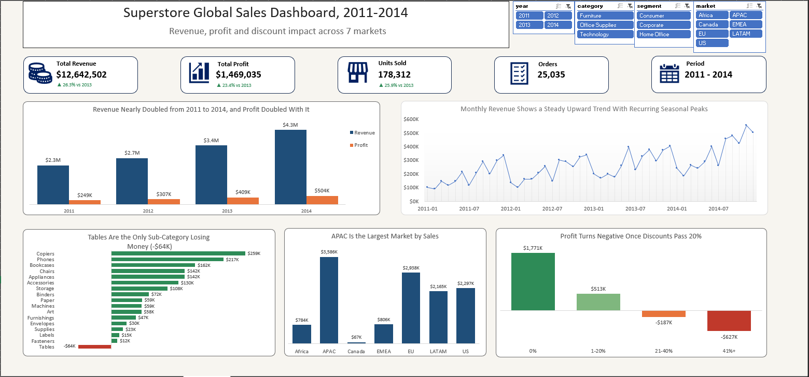

# Superstore Global Sales Dashboard (Excel)

An interactive Excel dashboard that analyses four years of global retail sales (2011-2014) to find where the business grows, where it loses money, and why.

## Problem

A global retailer wants to know: **How is the business growing, which markets and products drive profit, and where is money being lost?**

## Dataset

- **Superstore Sales Dataset** (Kaggle), global version
- 51,290 order lines, 25,035 unique orders, Jan 2011 to Dec 2014
- 7 markets, 147 countries, 3 categories, 17 sub-categories
- No missing values or duplicates; the Returns and People sheets were left out of scope

## Approach

1. **Prepared the data.** Converted the range to an Excel Table (`tblOrders`), formatted currency, percentages and dates, and added helper columns: `order_month`, `ship_days`, `profit_margin` and `discount_band`.
2. **Validated totals.** Checked revenue ($12,642,501.91), profit ($1,469,034.82) and units (178,312) against an independent calculation.
3. **Built pivot tables** on the Data Model for yearly KPIs, monthly trend, category and sub-category performance, market and region, discount bands and top products. Used a DAX measure for margin and a distinct count for orders.
4. **Created the dashboard**: KPI cards with year-over-year change, five PivotCharts, and slicers for year, category, segment and market.

## Key findings

1. **Strong growth.** Revenue rose from $2.26M (2011) to $4.30M (2014), up 90%. Profit rose from $249K to $504K, up 102%.
2. **Discounts above 20% destroy profit.** Orders with no discount earned +$1.77M and 1-20% earned +$513K. Orders at 21-40% lost $187K, and orders above 40% lost $627K.
3. **Tables is the only loss-making sub-category.** It lost $64K on $757K of sales, with an average discount of about 29%.
4. **Furniture is the weak category.** Its margin is 7.0%, against 14.0% for Technology and 13.7% for Office Supplies.
5. **APAC is the largest market** at $3.59M (28% of sales).
6. **EMEA is the weakest market.** Its margin is only 5.4%, with $44K profit on $806K of sales.
7. **Sales are seasonal.** September, November and December are above average every year; January and February are the weakest.
8. **Sales are spread widely.** The top 10 products make up only about 5% of revenue.

## Recommendations

- Cap discounts at about 20%, starting with Tables and other heavily discounted lines.
- Review Furniture pricing and costs.
- Investigate EMEA discounting, shipping costs and product mix before investing further.
- Plan stock and promotions around Q4, and use January and February for targeted campaigns.

## Dashboard features

- KPI cards: revenue, profit, units sold, orders, period, with 2014 vs 2013 change
- Five charts: yearly revenue and profit, monthly trend, profit by sub-category, sales by market, profit by discount band
- Slicers for year, category, segment and market connected to all pivots

> Note: the KPI cards show full-period totals and do not respond to the slicers.

## Tools

Microsoft Excel: Tables, PivotTables, PivotCharts, Data Model, DAX measures, slicers, conditional formatting

## Files

| File | Description |
|---|---|
| `superstore_sales.xlsx` | Full workbook with data, pivots, dashboard and Insights sheet |
| `dashboard.png` | Dashboard screenshot |
| `slicers.mp4` | Short demo of the slicers |

### Interactive demo

*Filtering by market and category updates all five charts.*

## Dataset source

Superstore Sales Dataset on Kaggle (link: [https://www.kaggle.com/datasets/amirmotefaker/superstore-sales-dataset])
